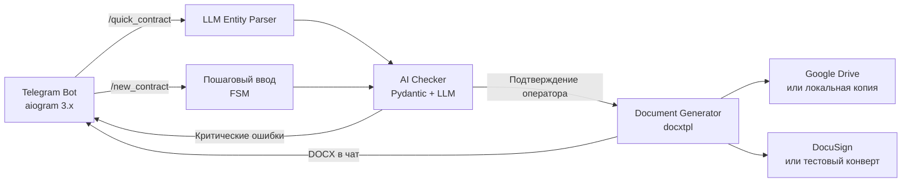

# 📑 AI DocFlow & Verification System

> Интеллектуальная система генерации, AI-аудита и цифрового подписания коммерческих документов через Telegram-интерфейс и облачные API.


## 💼 Бизнес-кейс и проблематика

Ручная подготовка типового договора или акта занимает до 30–40 минут. Перенос реквизитов из прошлых документов приводит к опечаткам в ИНН и расхождениям сумм цифрами и прописью. Исправления задерживают сделки, а ошибки в документах могут вызвать вопросы при налоговой проверке.

Оператор передаёт реквизиты через Telegram. Система извлекает данные из сообщения, оценивает риски и после подтверждения формирует документ, загружает его в Google Drive и передаёт в DocuSign для подписи.

| Показатель | Целевой результат |
| --- | --- |
| Извлечение реквизитов из свободного текста | До 3 секунд |
| Подготовка типового договора | С 35 минут до 45 секунд (около 98% экономии времени) |
| Доля документов с критическими ошибками в реквизитах | 0% в целевой контрольной выборке при двухуровневой проверке |
| Отправка на подпись | Автоматический запуск сразу после подтверждения оператором |

Целевые значения требуют замеров на рабочих данных. Время доставки приглашения зависит от внешних сервисов.

## 🏗 Архитектура решения



## ⚡ Ключевые возможности

1. **Quick AI Parse.** Бот извлекает реквизиты из свободного текста и запрашивает недостающие поля. Пошаговый сценарий доступен через `/new_contract`.
2. **Двухуровневый AI-аудит.** Локальные правила проверяют формат даты и контрольные цифры ИНН из 10 и 12 знаков. LLM сверяет суммы и оценивает формулировки, включая признаки подмены трудовых отношений договором ГПХ. Критические ошибки блокируют генерацию, а инлайн-кнопки позволяют исправить выбранное поле.
3. **Генерация и отправка.** Бот выдаёт DOCX в чате, загружает его в Google Drive и создаёт конверт DocuSign. Генератор также поддерживает отдельный экспорт в PDF через Word на Windows или LibreOffice на Linux.
4. **Резервный режим.** При недоступности LLM аудитор возвращает локальный отчёт и предупреждает о ручной сверке сумм и условий. При отсутствии учётных данных или ошибке аутентификации облачные адаптеры используют локальную копию и тестовый конверт.
5. **Автоматические тесты.** 23 модульных и интеграционных теста проверяют генератор, валидатор, облачные адаптеры и оба сценария Telegram. Внешние API подменяются моками.

## 🚀 Быстрый старт

Понадобится Python 3.10 или новее. Для клонирования подставьте URL вашего Git-репозитория. Если проект уже скачан, начните с создания виртуального окружения.

```bash
git clone "URL-репозитория" ai-docflow
cd ai-docflow
python -m venv .venv
```

| Среда | Активировать окружение | Создать локальную конфигурацию |
| --- | --- | --- |
| Windows PowerShell | `.\.venv\Scripts\Activate.ps1` | `Copy-Item .env.example .env` |
| Bash | `source .venv/bin/activate` | `cp .env.example .env` |

```bash
python -m pip install -r requirements.txt
pytest
python main.py
```

Консольный сценарий работает с пустыми ключами и сохраняет проверенный локальными правилами договор в `output/demo_contract.docx`. Облачные mock-адаптеры можно проверить через тесты или Telegram-бота.

### Настройка API

| Переменные в `.env` | Назначение | Поведение без настройки |
| --- | --- | --- |
| `TELEGRAM_BOT_TOKEN` | Токен бота Telegram | Скрипт сообщает об отсутствии токена и завершается с кодом `0` |
| `LLM_API_KEY`, `LLM_BASE_URL`, `LLM_MODEL` | Доступ к LLM для извлечения реквизитов и аудита | Быстрый сценарий переходит к пошаговому вводу, аудитор использует локальную проверку |
| `GOOGLE_SERVICE_ACCOUNT_FILE`, `GOOGLE_DRIVE_FOLDER_ID` | JSON-ключ сервисного аккаунта и папка на общем диске | Без ключа файл копируется в `output/cloud_storage/` |
| `DOCUSIGN_ACCOUNT_ID`, `DOCUSIGN_ACCESS_TOKEN`, `DOCUSIGN_BASE_PATH` | Аккаунт, OAuth-токен и адрес REST API | Без аккаунта или токена создаётся тестовый конверт, письмо не отправляется |

Реальная загрузка в Google Drive выдаёт ссылку с доступом на чтение всем, у кого она есть. В реальном режиме DocuSign отправляет ссылку на email подписанта. В режиме mock бот показывает имитацию ссылки в чате.

### Запуск Telegram-бота

Укажите `TELEGRAM_BOT_TOKEN` и запустите бот из корня проекта.

```bash
python run_bot.py
```

В личном чате отправьте `/new_contract` для пошагового ввода или `/quick_contract` и следующим сообщением передайте свободный текст.

> Договор № 42 от 11.11.2026 с ООО «Вектор», ИНН 7707083893. Услуга — разработка Telegram-бота. Стоимость 150 000 руб. (сто пятьдесят тысяч рублей).

Бот запросит оставшиеся реквизиты и контакты подписанта, затем покажет отчёт и кнопки подтверждения. Для остановки поллинга нажмите `Ctrl+C`.

### Пример вызова из Python

```python
from core.generator import DocumentGenerator, extract_text_from_docx

generator = DocumentGenerator()
text = extract_text_from_docx("output/demo_contract.docx")
print(text)

pdf_path = generator.convert_to_pdf("output/demo_contract.docx")
if pdf_path:
    print(pdf_path)
```

## 📊 Структура репозитория

```text
.
├── core/
│   ├── ai_checker.py             # Аудит договора и локальный резервный режим
│   ├── generator.py              # DOCX, извлечение текста и экспорт в PDF
│   └── schemas.py                # Данные договора и отчёт проверки
├── integrations/
│   ├── storage.py                # Google Drive и локальное хранилище
│   ├── signer.py                 # DocuSign и тестовые конверты
│   └── tg_bot/
│       ├── bot.py                # Диспетчер и поллинг
│       ├── handlers.py           # Команды, проверка и выдача документов
│       ├── keyboards.py          # Инлайн-кнопки
│       ├── parser.py             # Извлечение реквизитов через LLM
│       └── states.py             # Состояния диалога
├── templates/
│   └── contract_template.docx
├── scripts/
│   ├── create_base_template.py
│   └── generate_tz_document.py
├── tests/
├── output/
├── .env.example
├── config.py
├── main.py
├── requirements.txt
└── run_bot.py
```

[Техническое задание, версия 1.0](ТЗ_Система_автоматизации_документооборота_с_AI.docx)
